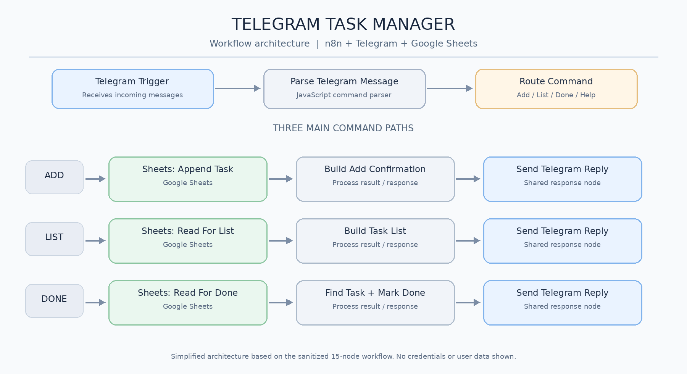

# Telegram Task Manager with n8n 🤖

**A Telegram-based task management automation powered by n8n, Google Sheets, and JavaScript.**

A practical workflow automation project that allows users to create, organize, view, and complete tasks directly from Telegram without switching between applications.

## 📌 Project Overview

This project demonstrates how multiple services can be integrated to automate a real-world task management process.

The workflow receives messages from a Telegram bot, processes commands using JavaScript in n8n, stores task information in Google Sheets, and sends responses back to the user.

It supports Persian task descriptions and basic date/time extraction.

**Project type:** Workflow Automation

**Status:** Core features implemented and tested

## 🛠️ Technologies Used

| Technology | Purpose |
|---|---|
| n8n | Workflow orchestration |
| Telegram Bot API | User interaction |
| Google Sheets API | Task storage and retrieval |
| JavaScript | Command parsing and data processing |
| Google OAuth2 | Secure Google Sheets authentication |

## ✨ Features

- Create tasks directly through Telegram messages.
- Store task records automatically in Google Sheets.
- Display incomplete tasks with unique task IDs.
- Mark tasks as completed.
- Record creation and completion timestamps.
- Support basic Persian commands and date/time formats.
- Restrict processing to private Telegram conversations.
- Optionally limit access to a specific Telegram user.

## 💬 Supported Commands

| Command | Description |
|---|---|
| `/start` | Display the bot instructions |
| `/help` | Show available commands |
| `/add Learn Python` | Create a new task |
| `/add Study Python \| 2026-12-01 \| 10:30` | Create a scheduled task |
| `/list` | Show incomplete tasks |
| `/done TASK_ID` | Mark a task as completed |
| `/today` | Show tasks scheduled for today |

**Testing status:** `/start`, `/add`, `/list`, and `/done` have been tested in the configured environment. The `/today` command is implemented but has not yet been independently verified.

## 🔄 Workflow Architecture

**Telegram Bot → Telegram Trigger → JavaScript Command Parser → Command Routing → Google Sheets → Telegram Response**

The workflow follows these steps:

1. A user sends a message to the Telegram bot.
2. Telegram Trigger receives the incoming event.
3. A JavaScript node identifies the requested action.
4. n8n routes the request to the appropriate operation.
5. Google Sheets stores, retrieves, or updates task data.
6. Telegram sends the result to the user.

The workflow contains 15 interconnected nodes.

## 📂 Repository Contents

| File | Description |
|---|---|
| [workflow.json](./workflow.json) | Sanitized n8n workflow, ready for import and configuration |
| README.md | Project documentation and setup instructions |

## 📊 Google Sheets Structure

Create a Google Spreadsheet with a worksheet named `Tasks`.

The first row must contain these columns:

`Task_ID`, `Chat_ID`, `Task`, `Due_Date`, `Due_Time`, `Status`, `Created_At`, `Completed_At`, `Source`

Task status values are `Open` and `Done`.

## 🚀 Installation and Setup

### Prerequisites

- A running n8n instance
- A Telegram bot created using BotFather
- A Google account with access to Google Sheets
- Google Sheets OAuth2 credentials
- A publicly reachable HTTPS webhook endpoint for Telegram Trigger

### Setup Instructions

1. Download `workflow.json` from this repository.
2. Import the file into n8n.
3. Create a Google Spreadsheet with a worksheet named `Tasks`.
4. Add the required column headers.
5. Configure your Telegram credentials in the Telegram Trigger and Telegram response nodes.
6. Configure Google Sheets OAuth2 credentials.
7. Select your spreadsheet in all four Google Sheets nodes.
8. Verify that each node targets the `Tasks` worksheet.
9. Configure a public HTTPS webhook endpoint for Telegram.
10. Save, test, and activate the workflow.

For self-hosted n8n installations, additional webhook configuration may be necessary.

## 🔐 Security Considerations

- Real API tokens and authentication credentials are not included in the public workflow.
- Credential references and private spreadsheet identifiers have been removed from the published template.
- Configure credentials securely within your own n8n instance.
- Do not publish private Google Sheets data or Telegram user information.
- For private use, configure `ALLOWED_TELEGRAM_USER_ID` in the JavaScript command parser.
- Review all credentials and settings before deploying the workflow.

## ✅ Tested Functionality

The following operations have been tested successfully in the configured environment:

- Receiving Telegram messages
- Creating tasks in Google Sheets
- Listing incomplete tasks
- Updating task status to `Done`
- Recording task completion timestamps
- Sending confirmation messages through Telegram

## ⚠️ Current Limitations

- The project uses rule-based JavaScript processing, not a large language model.
- Natural-language date parsing supports a limited set of patterns.
- Relative dates use the `Asia/Tehran` timezone.
- Numeric dates use the Gregorian `YYYY-MM-DD` format.
- Telegram Trigger requires a publicly reachable HTTPS webhook.
- Task listing currently displays up to 10 entries in each response.

## 🔮 Future Improvements

Potential next development steps:

- AI-powered natural-language task extraction
- Automatic task reminders
- Task priority management
- Improved date and time interpretation
- Python-based integrations
- Error handling and automated workflow tests

These are planned improvements, not implemented features.

## 👨‍💻 Author

**Mojtaba Sadeghi**

Computer Engineering graduate and M.Sc. student in Artificial Intelligence.

Interested in AI Automation, n8n, Python, REST API Integration, and Applied AI Engineering.

**GitHub:** [mojtaba-sadeghi-dev](https://github.com/mojtaba-sadeghi-dev)

---

*Built as a practical workflow automation project and a step toward developing more advanced AI-powered applications.*

## 🖼️ Workflow Preview

This simplified diagram illustrates the main workflow paths.

## 📊 Google Sheets Template

Download the [Google Sheets CSV Template](./tasks-template.csv).

Import the CSV into Google Sheets and name the worksheet `Tasks`. The template contains column headers only.

